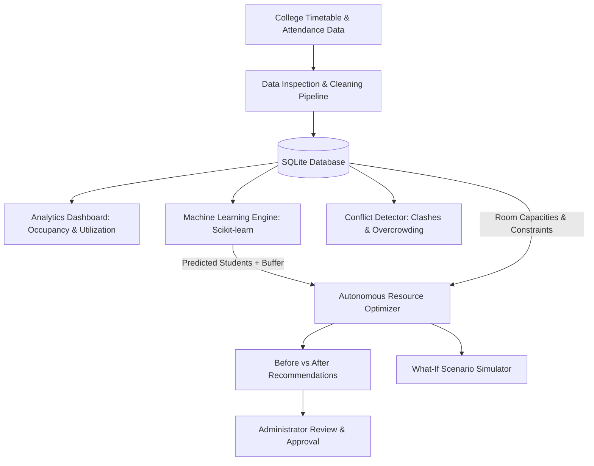

# AI-Powered Classroom Resource Optimization System

**A College Mini-Project for 3rd-Year B.Tech Students**  
*Predict. Analyze. Optimize.*

---

## 1. Project Overview & Problem Statement

College campuses frequently struggle with **inefficient physical classroom allocation**:
- **Underutilization:** A class of 45 students is scheduled in a 120-seat lecture hall, wasting cooling, lighting, and campus space.
- **Overcrowding:** A class with 85 students is scheduled in a 60-seat classroom, leading to seat shortages and timetable clashes.
- **Double Bookings:** Manual scheduling results in two professors assigned to the same room at the same time.

### The Solution:
This project implements an end-to-end, student-level **Data Analytics and Machine Learning web platform**:
1. Ingests and cleans timetable, classroom, and attendance logs.
2. Analyzes room occupancy and utilization trends across departments and time slots.
3. Predicts future student turnout using classical Machine Learning (Linear Regression & Random Forest).
4. Autonomously reallocates classes to the best-fit rooms using a transparent multi-constraint scoring algorithm.
5. Provides a **What-If Simulator** to test classroom closures or attendance surges without altering live data.

---

## 2. Complete Project Architecture & Data Flow



---

## 3. Technology Stack

- **Backend:** Python (Flask) — lightweight, beginner-friendly web server.
- **Data Processing:** Pandas, NumPy.
- **Machine Learning:** Scikit-learn (`LinearRegression`, `RandomForestRegressor`, `OneHotEncoder`, `Pipeline`).
- **Database:** SQLite (`classroom_optimizer.db`) — zero-configuration relational database.
- **Frontend:** Vanilla HTML5, CSS3 (Academic Design System), JavaScript (Fetch API).
- **Visualizations:** Chart.js (Interactive Web Dashboard), Matplotlib (Jupyter Notebook).
- **Notebook:** Jupyter Notebook (`classroom_resource_optimizer.ipynb`).

---

## 4. Project Directory Structure

```text
mini_project/
│
├── app.py                   # Main Flask application and API routes
├── db.py                    # SQLite database schema, helpers, and data seeding
├── cleaner.py               # Step-by-step Pandas data cleaning logic
├── predictor.py             # Machine learning inference module
├── optimizer.py             # Multi-constraint scoring algorithm engine
├── conflict_detector.py     # Timetable clash, capacity, and resource scanner
├── simulator.py             # What-if scenario stress-testing engine
├── event_predictor.py       # College event attendance & auditorium allocator
├── requirements.txt         # Python package dependencies
│
├── data/                    # Sample and pre-loaded datasets
│   ├── classrooms.xlsx / .csv
│   ├── timetable.xlsx / .csv
│   ├── attendance.xlsx / .csv
│   └── smart_occupy_5000.csv
│
├── models/                  # Pre-trained Scikit-learn models
│   ├── attendance_model.pkl (Random Forest)
│   └── linear_model.pkl     (Linear Regression)
│
├── notebooks/               # Step-by-step Jupyter Notebook
│   └── classroom_resource_optimizer.ipynb
│
├── templates/               # HTML5 templates
│   ├── layout.html          # Base navigation layout
│   ├── index.html           # Page 1: AI Assistant Landing
│   ├── requirements.html    # Page 2: Data Schemas & Templates
│   ├── upload.html          # Page 3: Upload & Clean Data
│   ├── dashboard.html       # Page 4: Interactive Analytics Dashboard
│   ├── prediction.html      # Page 5: Student Count Prediction
│   ├── optimizer.html       # Page 6: Autonomous Resource Optimizer
│   ├── simulator.html       # Page 7: What-If Simulator
│   ├── events.html          # Page 8: Event Predictor & Hall Allocator
│   ├── conflicts.html       # Page 9: Schedule Conflict Detection
│   └── summary.html         # Page 10: Executive Summary & Viva Review
│
└── static/
    ├── css/
    │   └── style.css        # Custom academic design system
    └── js/
        └── script.js        # Dynamic AJAX and Chart.js controller
```

---

## 5. How to Run Locally

### Step 1: Install Dependencies
Open your PowerShell or Command Prompt in the project folder and run:
```bash
pip install -r requirements.txt
```

### Step 2: Initialize Database (Optional, app does it automatically)
```bash
python db.py
```

### Step 3: Run the Web Application
```bash
python app.py
```
Open your browser and navigate to:  
👉 **`http://127.0.0.1:5000`**

### Step 4: Run the Jupyter Notebook
```bash
jupyter notebook notebooks/classroom_resource_optimizer.ipynb
```

---

## 6. How the Key Algorithms Work

### A. Attendance Prediction (Machine Learning)
- **Features:** `Department`, `Day of Week`, `Time Slot / Period`, `Semester Week`, `Historical Attendance Rate (%)`, `Exam Proximity (0, 1, 2)`.
- **Target:** `Actual_Student_Count`.
- **Model:** Scikit-Learn `LinearRegression` with `OneHotEncoder`.
- **Accuracy:** Mean Absolute Error (MAE) of **~5.3 students**, RMSE of **~9.3 students**.
- **Buffer:** Automatically adds a **+10% safety cushion** to prevent overcrowding.

### B. Autonomous Classroom Allocation Algorithm
The optimizer evaluates all college rooms against **6 operational constraints**:
1. **Constraint 1 (Hard):** `Capacity >= Predicted Students` (+40 points, rejects if deficit)
2. **Constraint 2 (Hard):** `Room Operational Status == Available` (+30 points)
3. **Constraint 3 (Hard):** `Room Free at Target Date & Time Slot` (+20 points)
4. **Constraint 4:** `Required Equipment (Projector / Lab) Present` (+15 points)
5. **Constraint 5 (Efficiency):** `Minimum Unused Capacity Bonus` (+0 to +20 points based on tightness of fit)
6. **Constraint 6 (Location):** `Department / Building Proximity` (+10 points)

Rooms are ranked by final score, and the top-ranked feasible room is recommended with a clear Before vs After comparison.

---

## 7. Viva Questions & Model Answers for 3rd-Year B.Tech Defense

#### Q1: What is the main objective of this project?
**Answer:** The goal is to optimize college classroom allocation by predicting student attendance using machine learning and matching classes to the most efficient room sizes, eliminating both underutilized lecture halls and overcrowded classrooms.

#### Q2: Why did you choose Linear Regression instead of Deep Learning?
**Answer:** Attendance records are structured tabular data with 5,000 sessions. Classical linear regression is highly interpretable, trains in milliseconds, does not overfit small datasets, and achieves a low Mean Absolute Error (~5.3 students), which is well within acceptable operational bounds.

#### Q3: How do you calculate Room Occupancy and Room Utilization?
**Answer:**
- **Occupancy %** = `(Actual Students / Room Capacity) * 100` (evaluates seat filling).
- **Room Utilization %** = `(Hours Used / Available Hours) * 100` (evaluates how many hours of the day a room is occupied).

#### Q4: How does the What-If Simulator differ from the live dataset?
**Answer:** The What-If Simulator operates on an isolated memory copy of active sessions to simulate hypothetical stress conditions (e.g. room closures for repairs, sudden attendance surges) without corrupting real college database records. All outputs are explicitly tagged as "Simulation Result".

#### Q5: How do you handle missing values during data cleaning?
**Answer:** Numeric columns (like attendance) are imputed using the **median**, which is robust to outliers compared to the mean. Categorical columns (like department or section) are imputed using the **mode**.

#### Q6: What are the project limitations?
**Answer:** The model relies on historical patterns. Unpredictable campus events (like sudden transport strikes or severe weather) cannot be predicted solely from historical timetables.

---

## 8. Academic Integrity & Honest Claim Policy
- **No 100% Accuracy Claim:** Model forecasts student attendance with ~5.3 students average error; actual attendance fluctuates.
- **Separation of Data:** Demo dataset (5,000 sessions) is clearly distinguished from uploaded user files and simulated what-if outputs.
- **Explainability:** All predictions and recommendations present transparent factor checklists so human academic deans retain final approval authority.
